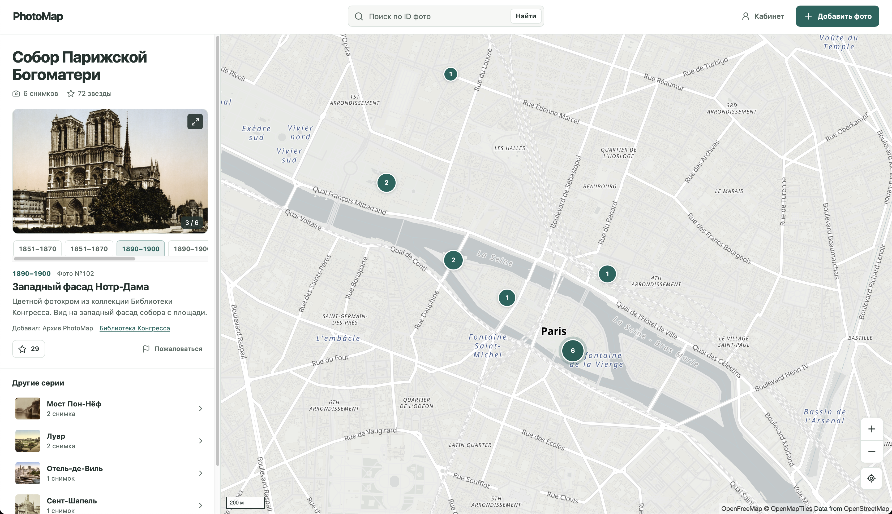

<!-- historical photo map API written in Go -->
# PhotoMap

PhotoMap показывает, как менялось одно и то же место. Выберите точку на карте, чтобы увидеть исторические снимки в порядке съёмки, или найдите конкретную фотографию по её ID. На скриншоте открыта серия собора Парижской Богоматери.

[Локальный запуск](#локальный-запуск) · [Архитектура](#архитектура) · [HTTP API](#http-api) · [Проверки](#проверки) · [Публичный запуск](#публичный-запуск)

## Возможности

| Кто | Что доступно |
| --- | --- |
| Гость | Выбрать серию на карте или в списке, переключаться между датами, искать по ID, открыть снимок целиком |
| Зарегистрированный пользователь | Загрузить снимок, указать на карте **изображённый объект**, посмотреть статус в кабинете, удалить своё фото, поставить или снять звезду, пожаловаться |
| Модератор | Просмотреть очередь и закрытые фотографии, исправить сведения и координаты, одобрить, отклонить, снять с публикации или восстановить снимок |

Публичная карта меняется без перезагрузки. Три активные жалобы от разных пользователей скрывают снимок до решения модератора. После восстановления сохраняются ID и звёзды. Каждый пользователь может пожаловаться на одну фотографию только один раз за всё время.

## Технологии

| Часть | Стек |
| --- | --- |
| Сервер и API | Go, `net/http`, chi v5, JSON, multipart/form-data, Server-Sent Events (SSE) |
| Хранение | SQLite в режиме WAL, `database/sql`, драйвер `modernc.org/sqlite`, sqlc, файловая система для изображений |
| Сессии | bcrypt из `golang.org/x/crypto`, JWT HS256 через `golang-jwt/jwt/v5`, SHA-256 для хешей токенов, HttpOnly cookie |
| Изображения и география | `disintegration/imaging`, JPEG и PNG из стандартной библиотеки, WebP из `golang.org/x/image`, расстояния через `golang/geo/s2` |
| Интерфейс | Vue 3, TypeScript, HTML, CSS, Tailwind CSS 4, Lucide Vue, MapLibre GL JS 5 и стиль Positron от OpenFreeMap |
| Разработка и сборка | Go toolchain, `testing` и `httptest`, Node.js, npm, Vite, `vue-tsc` |

Версии зависимостей указаны в [go.mod](server/go.mod) и [package-lock.json](web/package-lock.json).

## Локальный запуск

Для ветки Go 1.26 используйте 1.26.11 или более свежий исправляющий выпуск. Для фронтенда нужны Node.js 20.19+ в ветке 20 либо 22.12+ и npm. Команды ниже рассчитаны на macOS или Linux с OpenSSL и утилитой `sqlite3`. Для подложки карты браузеру нужен доступ к OpenFreeMap.

~~~sh
git clone https://github.com/vlonebara/photomap.git
cd photomap
go -C server mod download
npm --prefix web ci
~~~

**1. Подготовьте отдельный каталог данных.** В репозитории есть демонстрационная БД с фотографиями Парижа и тестовыми аккаунтами. Для собственного экземпляра создайте чистую базу. Следующие команды можно повторять, они сохраняют существующие базу и ключ.

~~~sh
PHOTOMAP_DATA="$HOME/.local/share/photomap"
umask 077
mkdir -p "$PHOTOMAP_DATA"
go -C server build -o "$PHOTOMAP_DATA/photomap" ./cmd

if [ ! -e "$PHOTOMAP_DATA/photomap.db" ]; then
    sqlite3 -bail "$PHOTOMAP_DATA/photomap.db" < server/db/schema/001_init.sql
fi
if [ ! -e "$PHOTOMAP_DATA/jwt.key" ]; then
    openssl rand -hex 32 > "$PHOTOMAP_DATA/jwt.key"
fi
~~~

**2. Запустите бэкенд в первом терминале.** Go ищет `photomap.db` и `media/` в текущем рабочем каталоге. Он создаст каталог изображений при первой загрузке.

~~~sh
cd "$PHOTOMAP_DATA"
export JWT_SECRET="$(cat jwt.key)"
export COOKIE_SECURE=false
./photomap
~~~

**3. Запустите фронтенд во втором терминале из корня клона.**

~~~sh
npm --prefix web run dev -- --host 127.0.0.1
~~~

Откройте адрес из вывода Vite, обычно [http://127.0.0.1:5173](http://127.0.0.1:5173). Запросы браузера к `/api` проходят через Vite на Go. Проверить процесс можно командой `curl http://localhost:8080/health`. На новой базе `curl http://localhost:8080/api/series` вернёт `[]`.

**4. Опубликуйте первый снимок.** Зарегистрируйте аккаунт через интерфейс. Чтобы открыть ему модерацию, выполните команду в отдельном терминале под пользователем, имеющим доступ к БД. Подставьте адрес зарегистрированного аккаунта. Результат `1` означает, что строка найдена.

~~~sh
sqlite3 "$HOME/.local/share/photomap/photomap.db" \
  "UPDATE users SET role='moderator' WHERE email='your-email@example.com'; SELECT changes();"
~~~

Обновите страницу. Нажмите «Добавить фото», выберите точку, приложите файл и укажите датировку. В шапке откройте кнопку со щитом «Модерация» и одобрите снимок. Он появится и у гостя с уже открытой картой. Чтобы увидеть новые заявки в уже открытой очереди, откройте её снова или переключите фильтр.

| Настройка | Значение |
| --- | --- |
| `JWT_SECRET` | Обязательный закрытый ключ длиной от 32 байт. Одно значение между запусками сохраняет действующие сессии |
| `COOKIE_SECURE` | `true` включает флаг Secure для HTTPS. При локальном HTTP оставьте `false` |
| `PHOTOMAP_API_TARGET` | Адрес бэкенда для прокси Vite. По умолчанию `http://localhost:8080` |
| HTTP и данные | Go слушает `:8080`. Схему нужно создать до запуска. `PHOTOMAP_DATA` выше — переменная командной оболочки для выбора каталога |

Для локального просмотра архива со скриншота можно положить **копии** `server/photomap.db` и `server/media/` в другой каталог и запустить там тот же бинарник с отдельным ключом. Используйте архив только в закрытой демонстрационной среде. [Команда подготовки демонстрационных данных](server/cmd/seed-demo)

## Архитектура

~~~mermaid
flowchart LR
    Browser["Vue в браузере"] -->|"запрос /api"| Handler["HTTP-обработчики Go"]
    Handler -->|"вызов"| Service["Сервисы"]
    Service -->|"запросы sqlc"| DB[("SQLite")]
    Service -->|"чтение и запись"| Media["Закрытый каталог media"]
    Service -->|"ревизия после COMMIT"| Events["События карты"]
    Events -->|"SSE"| Browser
    Browser -->|"подложка карты"| Tiles["OpenFreeMap"]
~~~

**Бэкенд.** `cmd/main.go` открывает SQLite, создаёт общий `Store`, сервисы и роутер. HTTP-обработчики отвечают за транспорт и права входа на маршрут. Сервисы проверяют владельца, роль и состояние снимка. Они работают с конкретным `db.Store` и типами sqlc. Запись внутри процесса сериализована. Связанные изменения в БД выполняются в одной транзакции.

| Каталог | Назначение |
| --- | --- |
| [cmd](server/cmd) и [server](server/server) | Сборка зависимостей, HTTP-сервер, таймауты и завершение работы |
| [handlers](server/handlers) | Маршруты, cookie, проверка происхождения запросов, приём файлов, JSON-ответы и поток SSE |
| [service](server/service) | Сессии, проверка данных, изображения, модерация, реакции и группировка серий |
| [db](server/db), [queries](server/db/queries), [schema](server/db/schema) | SQLite, транзакции, исходные запросы sqlc, ограничения и триггеры |

В БД хранятся пользователи, сессии, карточки, звёзды, жалобы, решения модераторов и ревизия карты. Триггеры обновляют счётчики и скрывают фото после третьей активной жалобы. Оригинал и миниатюра лежат в `media/`, доступ к файлу проверяется при каждом запросе. После удаления автором публичные ссылки перестают работать, запись и файлы сохраняются.

**Фронтенд.** `App.vue` связывает экран карты с панелями. Компоненты отображают данные, composables управляют запросами и выбранным снимком. Серии, статусы и счётчики клиент получает от Go. После `map.updated` он обновляет карту и ищет выбранную фотографию по её постоянному ID, даже если центр серии переместился.

| Каталог | Назначение |
| --- | --- |
| [src/App.vue](web/src/App.vue) и [src/main.ts](web/src/main.ts) | Главный экран и точка входа Vue |
| [src/api](web/src/api) | HTTP-клиент, методы API, DTO и преобразование ответов об ошибках |
| [src/composables](web/src/composables) | Загрузка карты, поиск, SSE, обновление списков и обратная связь в формах |
| [src/components](web/src/components) | Карта, карточка серии, полноразмерное фото, вход, кабинет, формы и модерация |
| [style.css](web/src/style.css) и [vite.config.ts](web/vite.config.ts) | Оформление, адаптивная вёрстка, сборка и локальный прокси |

**Как формируются серии.** Среди опубликованных фотографий сервер выбирает центры по убыванию звёзд, при равенстве — по меньшему ID. Новый центр появляется, если в радиусе 100 метров включительно ещё нет выбранного центра. Затем фотографии распределяются по ближайшим центрам, при равном расстоянии выигрывает меньший ID. Внутри серии снимки отсортированы по начальному году, затем по ID.

## HTTP API

Базовый адрес при локальном запуске — `http://localhost:8080`. Все пути в таблице, кроме `/health`, начинаются с `/api`. Клиент передаёт JSON или `multipart/form-data` для загрузки. Сеанс действует 24 часа. Сервер передаёт токен через cookie `session_token` с HttpOnly и SameSite=Lax и при каждом запросе сверяет его хеш с живой сессией в SQLite. Выход отзывает текущую сессию.

| Доступ | Метод и путь | Результат |
| --- | --- | --- |
| Всем | `GET /health` | `{"status":"ok"}` от HTTP-процесса |
| Всем | `POST /auth/register`, `POST /auth/login` | Регистрация (`name`, `email`, `password`) или вход (`email`, `password`), профиль и cookie |
| Сессия | `GET /auth/me`, `POST /auth/logout` | Текущий профиль или выход |
| Всем | `GET /series`, `GET /series/{id}` | Метки серий или серия с фотографиями |
| Всем | `GET /photos/{id}`, `GET /photos/{id}/image`, `GET /photos/{id}/thumbnail` | Карточка, оригинал или миниатюра опубликованного снимка |
| Всем | `GET /events` | Поток `map.updated` с номером ревизии |
| Сессия | `POST /photos` | Загрузка в статусе `pending` |
| Автор | `GET /me/photos`, `GET /me/photos/{id}`, `DELETE /me/photos/{id}` | Список своих без удалённых, отдельная карточка, снятие с доступа через `removed` |
| Автор | `GET /me/photos/{id}/image`, `GET /me/photos/{id}/thumbnail` | Свои файлы через закрытый маршрут |
| Сессия | `PUT /photos/{id}/star`, `DELETE /photos/{id}/star`, `POST /photos/{id}/reports` | Поставить или снять звезду, пожаловаться на опубликованный снимок |
| Модератор | `GET /moderation/photos` | Очередь `pending,review` по умолчанию, фильтр `?status=published` и другие статусы |
| Модератор | `GET /moderation/photos/{id}`, `PATCH /moderation/photos/{id}` | Прочитать или изменить сведения. `null` очищает необязательное поле |
| Модератор | `GET /moderation/photos/{id}/image`, `GET /moderation/photos/{id}/thumbnail` | Закрытые файлы |
| Модератор | `POST /moderation/photos/{id}/decision` | JSON с полем `action` для перехода из текущего статуса |

| Решение | Переход |
| --- | --- |
| `approve` | `pending → published` |
| `reject` | `pending / review → rejected` |
| `unpublish` | `published → rejected` |
| `restore` | `rejected / review → published` |

Загрузка принимает один файл `image` (JPEG, PNG или WebP, до 10 МиБ и 40 млн пикселей) и поля `title`, `description`, `place`, `longitude`, `latitude`, `year`. Необязательные поля — `endYear`, `sourceName`, `sourceUrl`. В ответе координаты идут в порядке `[долгота, широта]`. Год положительный, конец диапазона не может предшествовать началу или отстоять от него более чем на 50 лет. Источник открывается по HTTP или HTTPS.

Создание аккаунта, загрузка и первая жалоба возвращают `201`. Выход и удаление возвращают `204`. Недоступная публичная карточка и её файлы возвращают `404`. В JSON-ошибке есть `code`, `message` и, для ошибок полей, `fields`. Например, повторная жалоба получает `409 already_reported`. При занятых слотах входа или загрузки сервер отвечает `503 busy` с `Retry-After`.

[Контракт API для фронтенда](web/API.md) · [SQLite и генерация sqlc](server/db/README.md) · [Запуск и сборка фронтенда](web/README.md)

## Проверки

Из корня проекта выполните команды после установки зависимостей.

~~~sh
go -C server test ./...
go -C server test -race -tags=integration -count=1 ./...
go -C server vet -tags=integration ./...
npm --prefix web run build
~~~

Интеграционные тесты используют временные БД, файлы и локальные HTTP-серверы. Они проверяют сессии, права, публикацию, жалобы, конкурирующие звёзды и события карты. Сборка фронтенда проверяет типы и записывает статику в `web/dist`. Для локального просмотра сборки предназначена команда `npm --prefix web run preview`.

## Публичный запуск

Соберите фронтенд командой `npm --prefix web run build`. Раздавайте `web/dist` по HTTPS и проксируйте `/api/` с того же домена на Go. Прокси должен сохранять заголовок `Host`, пропускать multipart-запрос целиком и отключать буферизацию SSE. [Пример Nginx](web/README.md#публичный-запуск)

Используйте отдельную БД без демонстрационных аккаунтов, своего модератора, постоянный закрытый `JWT_SECRET` и `COOKIE_SECURE=true`. Ограничьте доступ к порту `8080` через сеть размещения. Храните БД и `media/` вне каталога статики и делайте согласованные резервные копии обоих.
